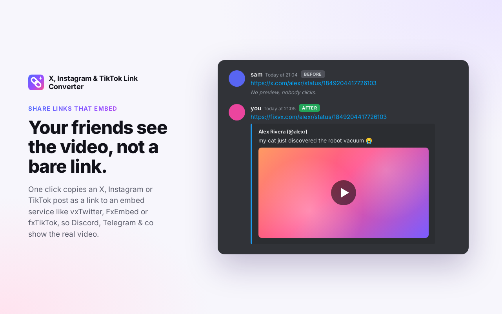

<h1 align="center">Embed Link Copier</h1>

for X, Instagram and TikTok

<b>Share links that embed.</b> One click copies an X, Instagram or TikTok post as a link to an embed service (vxTwitter, FxEmbed, fxTikTok…), so Discord, Telegram &amp; co show the video.

  <a href="https://chromewebstore.google.com/detail/ohmjcjchdjkedcmpnefjgffkdolelbih"><b>Add to Chrome</b></a> ·
  <a href="https://addons.mozilla.org/firefox/addon/x-instagram-link-converter/"><b>Add to Firefox</b></a> ·
  <a href="https://lepetitpaco.github.io/Embed-Link-Copier/">Website</a>

## How it works

| Site | Where | Default services |
|---|---|---|
| X / Twitter | Chips in the action bar of every post | `x` (clean x.com link), `vx` fixvx, `upx` fixupx, `vxt` vxtwitter |
| Instagram | Link button next to Share, and **kkinstagram** in the Share menu | `kk` kkinstagram |
| TikTok | Chips under Share on every video | `tnk` tnktok, `txk` tiktxk, `kk` kktiktok |

Click a chip and the converted link is in your clipboard. The popup (extension icon) copies the current page in any format; on the TikTok For You feed it uses the video on screen.

**Your own services**: in the popup, open **Services** to add, hide, reorder or reset services per site (a short label + a domain). The first ones become chips, the others go in a **⋯** menu. The list syncs with your browser account.

**Privacy**: no tracking, no analytics, nothing sent anywhere. Links are converted in your browser.

## Credits

This extension makes no embed itself: it only swaps the link's domain (`x.com/…` → `fixvx.com/…`). The previews come from these free services, run by their own authors. Star or sponsor them if you use them a lot:

- `fixvx.com`, `vxtwitter.com`: [vxTwitter](https://github.com/dylanpdx/BetterTwitFix) by dylanpdx
- `fixupx.com`: [FxEmbed](https://github.com/FxEmbed/FxEmbed) (formerly FxTwitter)
- `tnktok.com`: [fxTikTok](https://github.com/okdargy/fxTikTok) by okdargy
- `tiktxk.com`: [tiktxk](https://github.com/Britmoji/tiktxk) by Britmoji
- `kkinstagram.com`, `kktiktok.com`: [kkScript](https://kkscript.com) ([GitHub](https://github.com/kkscript))

Embed services come and go: the [website](https://lepetitpaco.github.io/Embed-Link-Copier/#services) lists the ones that still work, with alternatives you can add in the popup.

Not affiliated with these services, X Corp., Meta or TikTok.

---

[Changelog](CHANGELOG.md) · [Contributing](CONTRIBUTING.md) · [Website](https://lepetitpaco.github.io/Embed-Link-Copier/)
