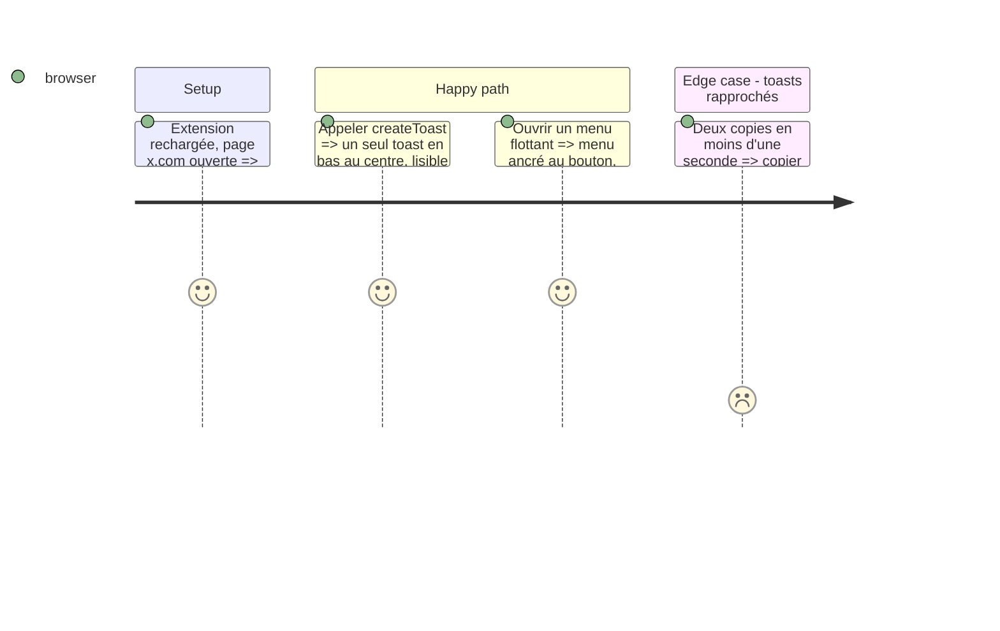

# Instruction: Kit UI partagé

## Architecture projection

```txt
.
├── utils.js   ✏️ injectStyles, toast redessiné, menu flottant, icônes
└── config.js  ✏️ libellés des actions (copie x.com / instagram)
```

## Test Scope



## Tasks to do

### `1)` Styles partagés

> Une feuille de style unique, injectée une fois, pour boutons, menu et toast.

1. `injectStyles()` idempotent (id `xilc-styles`), classes `xilc-*`, couleurs via `currentColor` et variables, `prefers-color-scheme`.

### `2)` Toast

> Toast discret qui ne recouvre pas la navigation et ne s'empile pas.

1. Bas-centre, `pointer-events:none`, réutilise le toast existant s'il est affiché.
2. Garder la signature `createToast(message, duration, link)`.

### `3)` Menu flottant

> `openQuickMenu(anchor, items)` : liste d'actions positionnée sous/au-dessus du bouton.

1. Position `fixed` calculée depuis `getBoundingClientRect`, retournée si pas de place en bas.
2. Fermeture : clic extérieur, Échap, défilement, redimensionnement ; un seul menu ouvert à la fois.
3. Navigation clavier (focus sur le premier item, flèches haut/bas, Entrée).

## Test acceptance criteria

| Task | Acceptance criteria |
| ---- | ------------------- |
| 1 | Une seule balise `#xilc-styles` dans la page même après plusieurs appels |
| 2 | Le toast apparaît en bas au centre et un second appel remplace le premier |
| 3 | Le menu s'ouvre collé au bouton, se ferme au clic extérieur, à Échap et au défilement |
