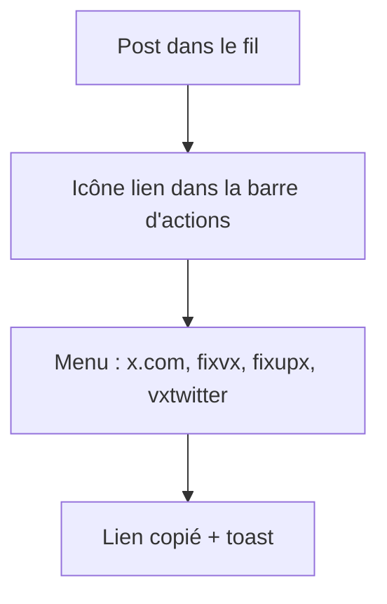
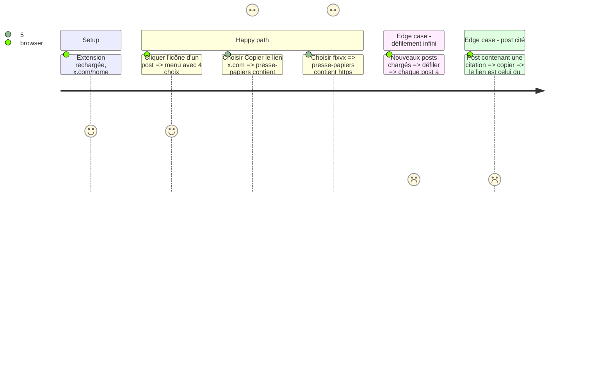

# Instruction: X — bouton compact et menu de copie

## Architecture projection

```txt
.
└── content-x.js  ✏️ bouton icône dans la barre d'actions, menu x.com + alternatives, suppression ligne de pilules et bouton survol
```

## User Journey



## Test Scope



## Wireframe

```txt
┌───────────────────────────────────────────────────────┐
│ (1) 💬 34   🔁 169   ♥ 2.2K   📊 54K     🔖 ⤴ [🔗]      │
└───────────────────────────────────────────────────────┘
                                         ┌──────────────┐
                                         │(2) x.com     │
                                         │    fixvx     │
                                         │    fixupx    │
                                         │    vxtwitter │
                                         └──────────────┘
```

1. Barre d'actions native : l'icône (3) est un enfant de plus, même taille que partager.
2. Menu flottant ancré à l'icône, alternatives filtrées par les réglages du popup.

## Tasks to do

### `1)` URL du post fiable

> Lien du post principal, nom d'utilisateur conservé.

1. Lire le lien du `time` hors citation (`a[href*="/status/"]:has(time)` non contenu dans un `div[role=link]`), sinon premier lien `/status/`.
2. Conserver `/<user>/status/<id>`, retirer `/photo/…`, `/analytics`, query.

### `2)` Icône dans la barre d'actions

> Un seul bouton icône par post, inséré dans `[role=group]`, marqué pour éviter les doublons.

1. Marquer l'article traité (`data-xilc`), sauter s'il l'est déjà.
2. Bouton `flex: 0 0 auto`, 34×34, couleur héritée, hover bleu.

### `3)` Menu de copie

> x.com toujours présent, puis alternatives activées.

1. Lire `enabledDomains` au clic, construire les items, copier, historique + stats.
2. Supprimer `createButtonsWithSettings`, `convertLinkInText` et les relances `setTimeout` multiples ; observer débouncé par frame.

## Test acceptance criteria

| Task | Acceptance criteria |
| ---- | ------------------- |
| 1 | Le lien copié pointe vers le post principal avec son nom d'utilisateur |
| 2 | Chaque post a une icône dans sa barre d'actions et sa hauteur ne change pas à l'injection |
| 3 | Le menu propose x.com et les alternatives activées ; le choix copie le bon lien et affiche un toast |
