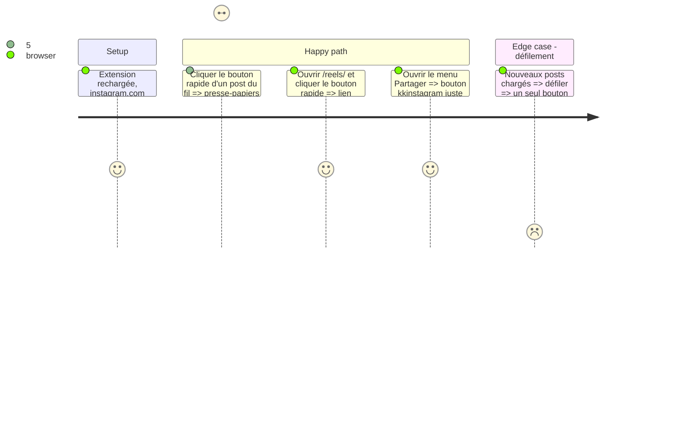

# Instruction: Instagram — bouton rapide partout

## Architecture projection

```txt
.
└── content-instagram.js  ✏️ bouton rapide dans les barres d'actions (fil, page post, reels), bouton du menu de partage conservé
```

## Test Scope



## Wireframe

```txt
Fil / page post :
┌──────────────────────────────────────────────┐
│ (1) ♡  💬 24  🔁 25  ➤  [kk]             🔖  │
└──────────────────────────────────────────────┘
Reels (colonne) :
  ♡ / 💬 / 🔁 / ➤ / (2)[kk] / 🔖 / ⋯
```

1. Bouton rapide après Partager, même taille que les icônes natives.
2. Dans la colonne verticale des reels, inséré après Partager.

## Tasks to do

### `1)` Repérer les barres d'actions

> Partir de l'icône Partager (svg du bouton situé entre Republier/Commenter et Enregistrer) sans dépendre de la langue.

1. Repérer la barre via le bouton dont le svg est suivi d'un bouton Enregistrer dans la même section, ou via `aria-label` connus multi-langues en secours.
2. Marquer la barre (`data-xilc`) pour ne jamais insérer deux fois.

### `2)` URL du post

> Lien `/p/<id>/` ou `/reel/<id>/` de l'article ; à défaut, URL de la page (reels, page post).

1. Article : premier lien `/p/` ou `/reel/` nettoyé.
2. Hors article : `location.pathname`.

### `3)` Bouton rapide

> Un clic copie kkinstagram, toast, historique ; respecte `enabledDomains.kkinstagram`.

## Test acceptance criteria

| Task | Acceptance criteria |
| ---- | ------------------- |
| 1 | Chaque barre d'actions du fil, de la page post et des reels a exactement un bouton kk, sans changer la hauteur |
| 2 | Le lien copié correspond au post ou reel sur lequel on a cliqué |
| 3 | Un clic copie le lien kkinstagram et affiche le toast |
