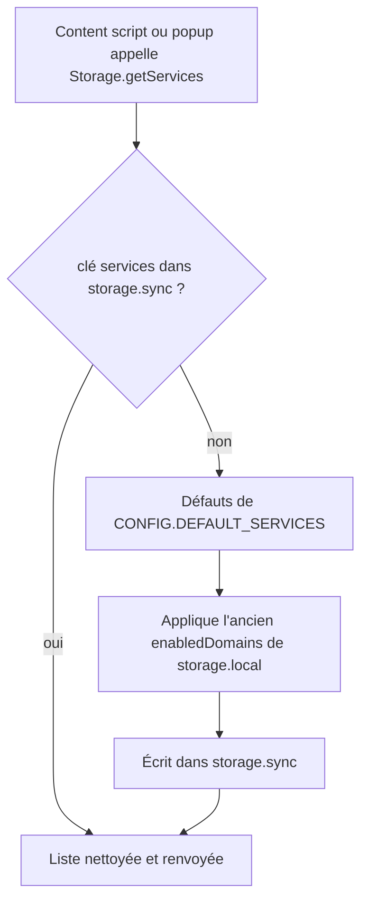
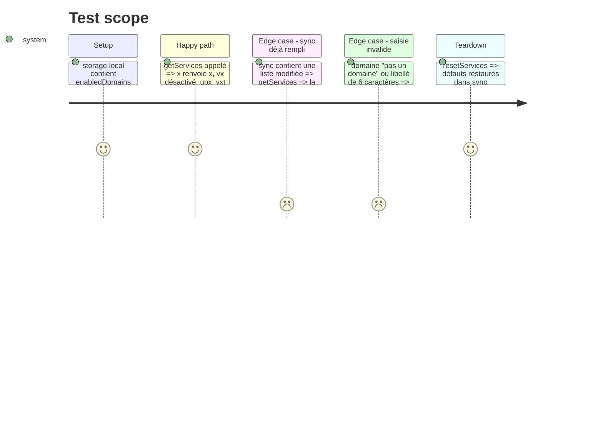

# Instruction: Modèle de services, stockage sync et migration

## Architecture projection

```txt
.
├── config.js     ✏️ CONFIG.DEFAULT_SERVICES par plateforme (x, instagram, tiktok), limites d'affichage, regex de validation
└── storage.js    ✏️ getServices / saveServices / resetServices (storage.sync), migration de enabledDomains, validateService
```

## User Journey



## Test Scope



## Tasks to do

### `1)` Défauts dans config.js

> Les services livrés sont décrits une seule fois.

1. Ajouter `DEFAULT_SERVICES` : x = x.com, fixvx, fixupx, vxtwitter ; instagram = kkinstagram ; tiktok = tnktok, tiktxk, kktiktok (tous actifs).
2. Ajouter `MAX_VISIBLE` : x 3, instagram 1, tiktok 2 ; `MAX_SERVICES` par plateforme : 10 ; `LABEL_MAX` : 4.
3. Retirer `TIKTOK_ALTERNATIVES`/`X_ALTERNATIVES`/`INSTAGRAM_ALTERNATIVES` une fois plus utilisés (phase 2-3), garder les `*_DOMAINS`.

### `2)` API de stockage des services

> Lire, écrire, réinitialiser et valider la liste.

1. `getSyncStorage()` (chrome.storage.sync ou browser.storage.sync, repli local si indisponible).
2. `validateService({label, domain})` : libellé 1 à 4 caractères sans espace, domaine en minuscules conforme à une regex de nom d'hôte ; renvoie un message d'erreur ou null.
3. `getServices()` : renvoie `{x, instagram, tiktok}` ; complète une plateforme absente par ses défauts ; filtre les entrées invalides.
4. Migration : si `services` absent de sync, partir des défauts, appliquer `enabledDomains` (local) par clé historique (`xcom`, `fixvx`, `fixupx`, `vxtwitter`, `kkinstagram`, `tnktok`, `tiktxk`, `kktiktok`), écrire dans sync.
5. `saveServices(services)` et `resetServices(platform?)`; exposer `SERVICES_KEY` pour `onChanged`.
6. Retirer `getSettings`/`saveSettings` et les défauts `enabledDomains` une fois les appelants migrés.

## Test acceptance criteria

| Task | Acceptance criteria |
| ---- | ------------------- |
| 1 | `CONFIG.DEFAULT_SERVICES.tiktok` liste tnk, txk, kk actifs dans cet ordre |
| 2 | Une install 1.1.0 avec fixvx décoché obtient `vx` désactivé après migration, et sync contient la liste |
| 2 | Une liste déjà en sync n'est jamais écrasée par la migration |
| 2 | `validateService` refuse un domaine sans point, avec espace ou majuscule non normalisée, et un libellé de plus de 4 caractères |
