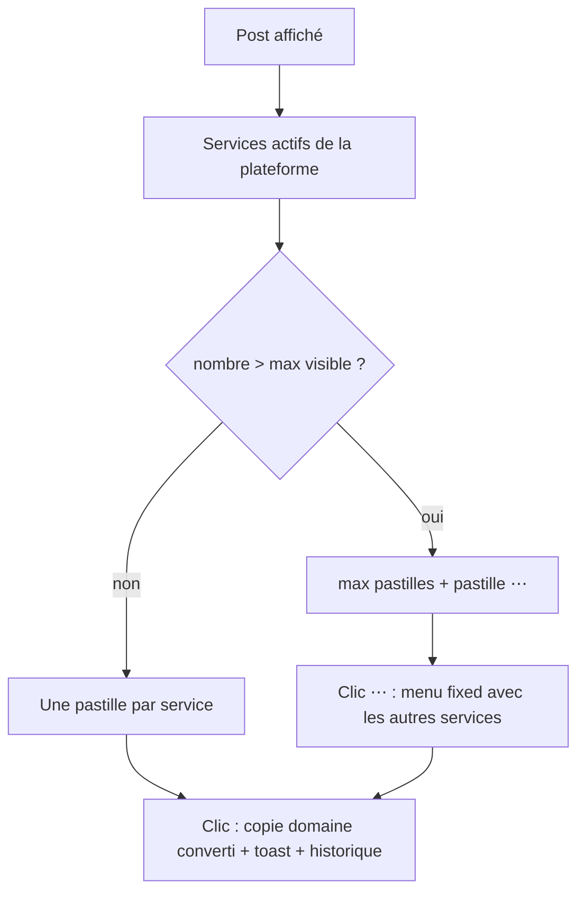

# Instruction: Rendu in-page, pastilles et menu « ⋯ »

## Architecture projection

```txt
.
├── utils.js              ✏️ renderServiceButtons(services, max, opts) + menu de débordement fixed, styles xilc-more / xilc-menu
├── content-x.js          ✏️ lit les services x, pastilles via renderServiceButtons (3 visibles)
├── content-instagram.js  ✏️ bouton icône = 1er service actif, « ⋯ » pour les autres ; bouton du menu Partager = 1er service
└── content-tiktok.js     ✏️ pastilles via renderServiceButtons (2 visibles)
```

## User Journey



## Test Scope

```mermaid
---
title: Test scope
---
journey
  section Setup
    Extension rechargée, onglet connecté sur le site => services par défaut: 5: browser
  section Happy path
    X fil => 3 pastilles x vx upx puis ⋯ ; clic ⋯ puis vxt => toast avec le lien vxtwitter: 5: browser
    TikTok fil => tnk txk puis ⋯ ; clic ⋯ puis kk => toast avec le lien kktiktok: 5: browser
    Instagram fil => bouton lien après Partager copie kkinstagram, pas de ⋯ avec un seul service: 5: browser
  section Edge case - menu ouvert
    Menu ⋯ ouvert => clic ailleurs, Échap ou défilement => le menu se ferme sans copier: 1: browser
  section Edge case - aucun service actif
    Tous les services d'une plateforme décochés => page affichée => aucun bouton injecté et aucune erreur console: 1: browser
  section Edge case - réglage modifié
    Service ajouté dans le popup => onglet ouvert => les boutons sont reconstruits sans recharger: 1: browser
```

## Wireframe

```txt
X (barre horizontale)                         TikTok (barre verticale)
┌──────────────────────────────────────────┐  ┌──────┐
│ 💬 🔁 ♥ 📊 🔖 ⇪ (1)[x][vx][upx][⋯]          │  │  ⇪   │ Partager natif
└──────────────────────────────────────────┘  │ [tnk]│ (1)
                       ┌───────────────┐     │ [txk]│
                       │ vxt  vxtwitter│ (2) │ [ ⋯ ]│
                       │ ...           │     └──────┘
                       └───────────────┘
Instagram : ♥ 💬 ⇪ (3)[🔗][⋯ si >1 service]
```

1. Pastilles visibles, dans l'ordre de la liste, jusqu'au maximum de la plateforme.
2. Menu flottant ancré sous/à côté de la pastille ⋯ : libellé + domaine par ligne.
3. Instagram : un bouton icône pour le premier service, ⋯ seulement s'il y en a d'autres.

## Tasks to do

### `1)` Kit partagé dans utils.js

> Un seul rendu de pastilles et de menu pour les trois sites.

1. `renderServiceButtons(services, maxVisible, { className, getUrl, platform, renderFirst })` renvoie un conteneur ; les pastilles copient `convertUrl(getUrl(), domain)`, flash ✓, toast, historique/stats.
2. Pastille `⋯` ouvrant un menu `position: fixed` sur `document.body`, positionné depuis `getBoundingClientRect` et gardé dans la fenêtre ; un seul menu ouvert à la fois ; fermeture au clic extérieur, Échap, défilement, redimensionnement.
3. Styles `xilc-more`, `xilc-menu`, `xilc-menu-item` (thème clair/sombre via `prefers-color-scheme`).

### `2)` X

> Les pastilles viennent de la liste x.

1. Remplacer `QUICK_LINKS` par les services x ; écouter `storage.onChanged` sur la zone `sync` et la clé `SERVICES_KEY`.

### `3)` Instagram

> Bouton rapide et menu Partager suivent la liste instagram.

1. Bouton icône = premier service actif ; `⋯` si plus d'un service actif.
2. Bouton cloné dans le menu Partager : libellé = domaine sans TLD du premier service actif.
3. Aucun bouton si aucun service actif.

### `4)` TikTok

> Pastilles depuis la liste tiktok, 2 visibles.

1. Remplacer `TIKTOK_QUICK_LINKS` par les services tiktok via le kit partagé.

## Test acceptance criteria

| Task | Acceptance criteria |
| ---- | ------------------- |
| 1 | Avec plus de services que le maximum, une pastille ⋯ apparaît et son menu liste exactement les services restants |
| 1 | Le menu se ferme au clic extérieur, à Échap et au défilement, et n'altère pas la mise en page du site |
| 2 | Sur X, x/vx/upx visibles et vxt dans le menu ; le clic copie le bon domaine |
| 3 | Sur Instagram, le bouton copie le lien du premier service ; le bouton du menu Partager porte son nom |
| 4 | Sur TikTok, tnk/txk visibles et kk dans le menu |
| 2-4 | Un changement de services dans le popup met à jour les onglets ouverts sans rechargement |
