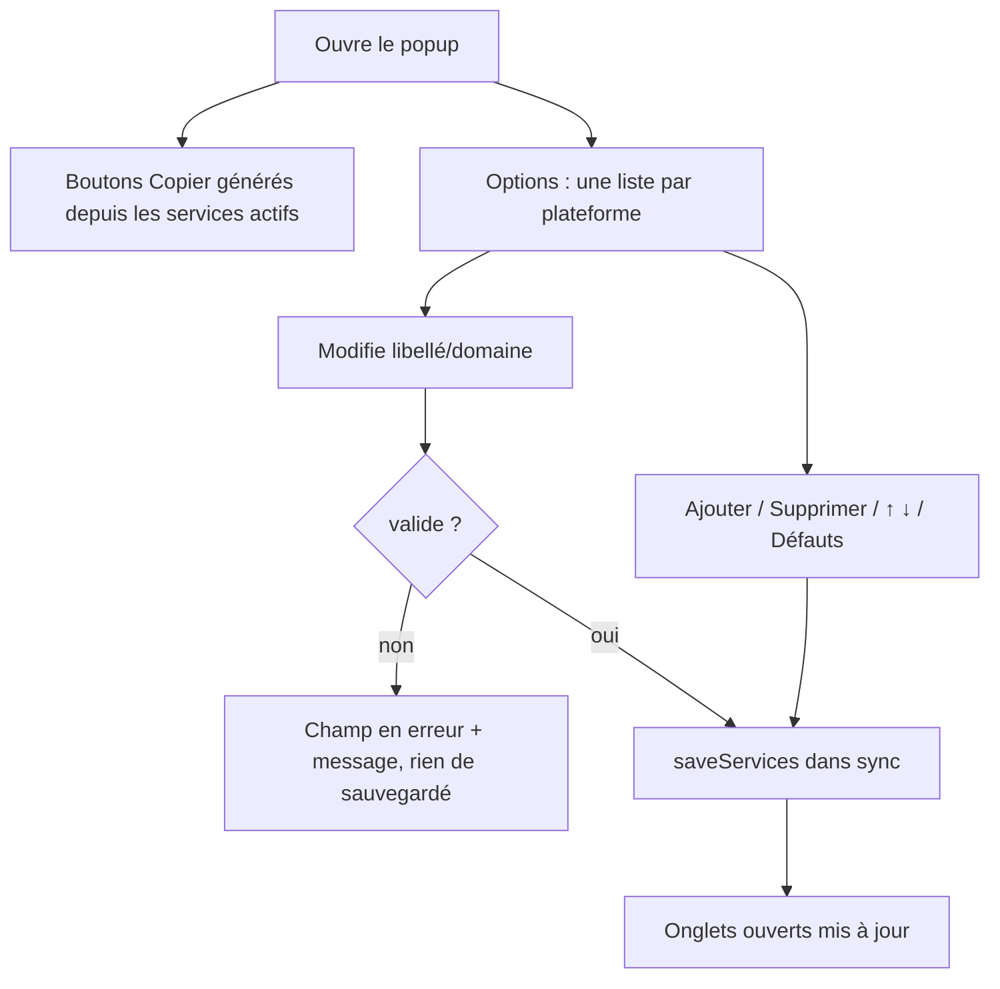
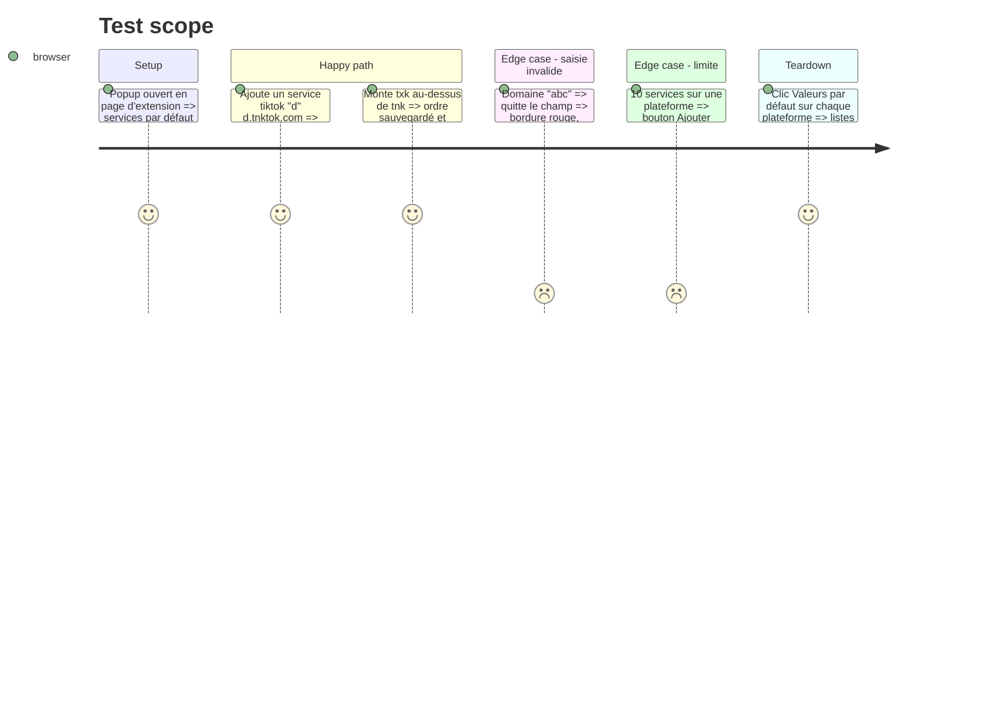

# Instruction: Popup, éditeur de services et copie dynamique

## Architecture projection

```txt
.
├── popup.html   ✏️ charge config.js ; sections de copie et d'options générées, styles des lignes éditables
└── popup.js     ✏️ supprime le CONFIG inline ; rend boutons de copie + éditeur par plateforme (ajout, suppression, ↑↓, activé, défauts)
```

## User Journey



## Test Scope



## Wireframe

```txt
┌────────────────────────────────────┐
│ Stats (1)                          │
├────────────────────────────────────┤
│ X / Twitter                    (2) │
│ [Copy x] [Copy vx] [Copy upx] ...  │
│ Instagram / TikTok idem            │
├────────────────────────────────────┤
│ Services                       (3) │
│ ▸ X / Twitter                      │
│  [✓][x  ][x.com        ][↑][↓][✕]  │
│  [✓][vx ][fixvx.com    ][↑][↓][✕]  │
│  [+ Ajouter]   [Valeurs par défaut]│
│ ▸ Instagram   ▸ TikTok             │
├────────────────────────────────────┤
│ Historique (4)                     │
└────────────────────────────────────┘
```

1. Statistiques inchangées (X, Instagram, TikTok).
2. Boutons de copie générés : un par service actif, libellé = domaine.
3. Éditeur par plateforme (`<details>` repliables) : case activée, libellé, domaine, monter, descendre, supprimer ; ajout et réinitialisation.
4. Historique inchangé.

## Tasks to do

### `1)` Une seule config

> Le popup lit `config.js`.

1. Charger `config.js` avant `storage.js` dans `popup.html` ; supprimer le `CONFIG` inline de `popup.js` et y garder seulement les validateurs d'URL de plateforme.

### `2)` Boutons de copie générés

> La copie depuis le popup suit les services actifs.

1. Rendre un bouton par service actif dans chaque section ; `getPostLink(domain, platform)` enregistre le domaine dans l'historique.

### `2b)` Vidéo TikTok affichée

> Depuis le popup, copier n'importe quel service (y compris personnalisé) pour la vidéo à l'écran, même sur le fil.

1. `content-tiktok.js` écoute `runtime.onMessage` `{ type: 'xilc-current-url' }` et renvoie l'URL de l'article le plus visible dans la fenêtre.
2. Le popup interroge l'onglet TikTok actif via `tabs.sendMessage` ; à défaut de réponse, il retombe sur l'URL de l'onglet (page d'une vidéo).

### `3)` Éditeur de services

> Modifier la liste sans mise à jour de l'extension.

1. Une ligne par service (case, libellé, domaine, ↑, ↓, ✕) construite en DOM (pas d'`innerHTML` sur des valeurs saisies).
2. Validation au `change` via `Storage.validateService` ; en erreur, bordure rouge + message dans la section, pas de sauvegarde.
3. Ajouter (ligne vide en édition, sauvegardée une fois valide), limite `MAX_SERVICES` ; Valeurs par défaut par plateforme.
4. Chaque sauvegarde re-rend les boutons de copie.

## Test acceptance criteria

| Task | Acceptance criteria |
| ---- | ------------------- |
| 1 | Le popup s'ouvre sans erreur console et `popup.js` ne contient plus de liste de domaines |
| 2 | Décocher un service retire son bouton Copier immédiatement |
| 2b | Sur tiktok.com/foryou, un bouton Copier du popup copie le lien de la vidéo à l'écran avec le domaine du service |
| 3 | Un service ajouté et valide est visible sur le site sans recharger l'onglet |
| 3 | Une saisie invalide affiche une erreur et ne modifie pas la liste sauvegardée |
| 3 | Valeurs par défaut restaure la liste d'origine de la plateforme |
