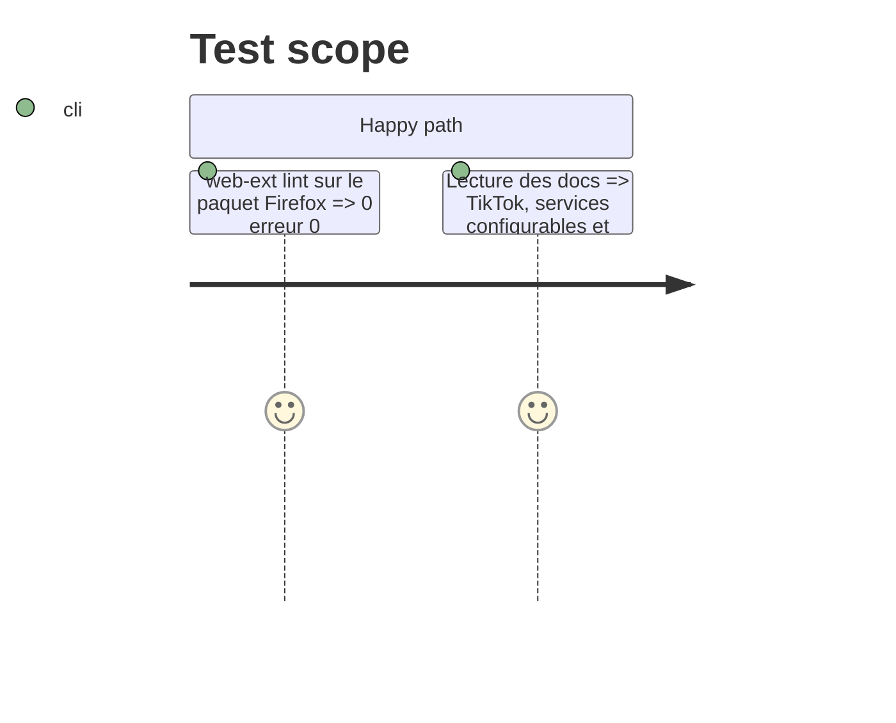

# Instruction: Version 1.2.0, docs et justifications store

## Architecture projection

```txt
.
├── manifest.json, manifest-v2.json, manifest-v3.json   ✏️ version 1.2.0
├── README.md                                           ✏️ services configurables, menu ⋯, changelog 1.2.0
├── CLAUDE.md                                           ✏️ modèle de services, storage.sync, kit utils
└── docs/
    ├── CHROME_PRIVACY_JUSTIFICATIONS.txt               ✏️ hôtes TikTok, storage.sync
    ├── CHROME_STORE_DESCRIPTION.txt                    ✏️ TikTok + services configurables
    └── STORE_DESCRIPTIONS.md                           ✏️ idem
```

## Test Scope



## Tasks to do

### `1)` Version et docs

> Prêt pour publication, sans commit.

1. Passer les trois manifests en 1.2.0 (CRLF conservés).
2. README : fonctionnalités, utilisation des services et du menu ⋯, changelog 1.2.0 (remplace « Unreleased »).
3. CLAUDE.md : section services (config par défaut, sync, migration, kit `renderServiceButtons`).
4. Docs store : TikTok, services configurables ; justification `storage` mise à jour (réglages synchronisés via le compte du navigateur, historique local) ; justification des hôtes TikTok.

## Test acceptance criteria

| Task | Acceptance criteria |
| ---- | ------------------- |
| 1 | Les trois manifests annoncent 1.2.0 et le lint Firefox est propre |
| 1 | Aucune doc n'affirme encore que les réglages restent uniquement en local |
